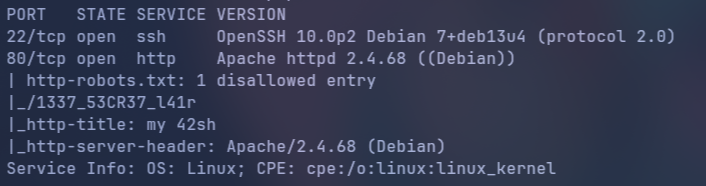

# H4ck3rz

## Contexte
- **Nom du challenge** : H4ck3rz
- **Catégorie** : Web
- **Difficulté** : Medium
- **Objectif** : obtenir un accès sur la machine et lire `user.txt`.


---

## 1. Reconnaissance

Le scan `nmap` révèle les deux ports ouverts et un `robots.txt`
intéressant :



---

## 2. Collecte d'identifiants (information disclosure)

- **Page d'accueil (`/`)** : un commentaire HTML caché révèle un **nom d'utilisateur** :
  `d4rk_T1t0u4N`.
- **Chemin caché `/1337_53CR37_l41r/`** : la page contient un **mot de passe en clair** :
  `8ES7_SHeLL_Ev4H`.

---

## 3. Énumération web

`gobuster` sur la racine du site révèle des fichiers PHP non liés depuis la page
principale :

```bash
gobuster dir -u http://<IP>/ -w <wordlist> -x php
```

```
/login.php
/portal.php
/forbidden.php
```

---

## 4. Authentification

Le couple identifiant / mot de passe trouvé fonctionne sur `login.php` (POST) :

```
user     : d4rk_T1t0u4N
password : 8ES7_SHeLL_Ev4H
```

La connexion fournit un cookie de session et donne accès à `portal.php`.

---

## 5. Exécution de commande arbitraire (RCE)

`portal.php` expose un **"Shell Panel"** qui exécute directement les commandes entrées
côté serveur → **RCE confirmée** :

```bash
id
# -> uid=33(www-data) gid=33(www-data) groups=33(www-data)
```

Un **filtre de mots-clés** bloque certaines commandes (`cat` notamment). Il se contourne
avec des équivalents non filtrés :

```bash
ls                    # lister
awk 1 <fichier>       # à la place de cat
```

---

## 6. Escalade horizontale (www-data → titouan) et lecture de user.txt

`sudo -l` en tant que `www-data` révèle une **mauvaise configuration sudo** :

```
User www-data may run the following commands on h4xx0r_pc:
    (titouan) NOPASSWD: ALL
```

**Faille** : `www-data` peut exécuter **n'importe quelle commande** en tant que `titouan`,
sans mot de passe, à cause du `ALL` (au lieu d'une liste restreinte de commandes).

Le fichier `/home/titouan/user.txt` a les permissions `r--------` (illisible directement
par `www-data`). On le lit via sudo :

```bash
sudo -u titouan awk 1 /home/titouan/user.txt
```

→ **flag `user.txt` obtenu**.

---

## Récapitulatif de la chaîne d'attaque

| Étape | De → Vers | Vecteur exploité |
|-------|-----------|------------------|
| 1 | — | `robots.txt` + commentaire HTML → fuite d'infos |
| 2 | — | Identifiants web récupérés (`login.php`) |
| 3 | → `www-data` | RCE via Shell Panel mal sécurisé (`portal.php`) |
| 4 | `www-data` → `titouan` | Misconfiguration sudo (`NOPASSWD: ALL`) → `user.txt` |

> La suite (escalade `titouan` → `root` et lecture de `root.txt`) est traitée dans le
> rapport **H4ck3rz #2**.

---

## Outils utilisés
- `nmap` — scan des ports et détection de services
- `gobuster` — énumération des fichiers/répertoires web
- `curl` / navigateur — accès aux pages et authentification
- `awk` — lecture de fichiers (contournement du filtre `cat`)
- `sudo` — élévation de privilèges

## Techniques utilisées
- **Information disclosure** (`robots.txt`, commentaire HTML)
- **Énumération web** de fichiers non liés (gobuster)
- **Fuite d'identifiants en clair**
- **RCE** via un panneau d'exécution de commandes mal sécurisé
- **Contournement de filtre de mots-clés** (`awk` au lieu de `cat`)
- **Privilege escalation via sudo** mal configuré (`NOPASSWD: ALL`)
